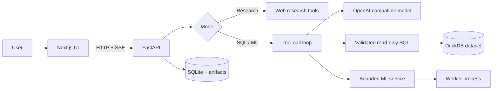

# Lumen

Lumen is a local-first data workspace with separate Research Chat, SQL Agent,
and ML Agent modes. A Next.js interface streams work from a FastAPI service;
an OpenAI-compatible model selects bounded tools while deterministic Python
code performs data access and machine-learning operations.

## Why I Built This

Conversational analytics is difficult to trust when queries, intermediate
results, and model choices are hidden. Lumen keeps SQL, timings, result tables,
charts, experiment records, and saved models inspectable while limiting what
the language model can execute.

## Key Features

- CSV and Parquet upload with compact schema profiling
- parsed, read-only DuckDB queries with time and row limits
- durable conversations and artifacts in SQLite
- server-sent events for activity, results, charts, and answers
- local supervised learning, clustering, forecasting, anomaly detection, and prediction
- isolated ML worker processes with cancellation and runtime limits
- controlled Research Chat web search when a Tavily key is configured
- responsive Next.js UI with Apache ECharts and restorable conversations

## Architecture



The model receives bounded metadata, recent context, and limited tool results;
it never receives a general Python execution tool or an entire training matrix.
See [Architecture](docs/architecture.md) for the component and failure model.

## Tech Stack

- **Frontend:** Next.js 15, React 19, TypeScript, Apache ECharts
- **Backend:** FastAPI, Pydantic, HTTPX, server-sent events
- **AI/ML:** OpenAI-compatible tool calling, pandas, scikit-learn, joblib
- **Data:** DuckDB for analytical queries; SQLite for application state
- **Testing:** pytest, Playwright, TypeScript compiler

## How It Works

1. The user selects a mode and, for SQL/ML work, uploads a CSV or Parquet file.
2. The backend profiles the dataset and stores metadata without placing the raw dataframe in the prompt.
3. The configured model requests only the tools available to that mode.
4. SQL is parsed and restricted to the registered `data` relation. ML requests are validated and executed in a child process.
5. Results and provenance are persisted, then streamed to the browser as inspectable artifacts.
6. Older conversation context is compacted while the underlying SQL, charts, and ML records remain available.

## Project Structure

```text
backend/          FastAPI API, agent loop, storage, SQL and ML services
frontend/         Next.js application and Playwright tests
docs/             Architecture, setup, and design decisions
examples/         Synthetic CSV datasets for demonstrations
scripts/          Optional local launcher
data/             Private runtime state; ignored except for its README
```

## Setup

Prerequisites: Python 3.11+, Node.js 20.9+, and an OpenAI-compatible chat
completions endpoint that supports function/tool calling.

```bash
cd backend
python -m venv .venv
.venv/bin/pip install -e '.[test]'
cp ../.env.example .env
# Edit the model endpoint and model ID in .env.
.venv/bin/uvicorn app.main:app --reload --host 127.0.0.1 --port 8000
```

In another terminal:

```bash
cd frontend
npm ci
cp .env.local.example .env.local
npm run dev
```

Open `http://127.0.0.1:3000`. Full configuration and verification commands are
in [Setup](docs/setup.md).

## Example Usage

- Upload `examples/sales.csv` in SQL mode and ask: “What are the top products by revenue?”
- Upload `examples/ml_customers.csv` in ML mode and ask: “Predict churned, excluding order_value.”
- Upload `examples/monthly_sales.csv` in ML mode and ask: “Forecast monthly revenue for the next three months.”
- In Research Chat, ask a current-information question after configuring `TAVILY_API_KEY`.

## Screenshots / Demo

Screenshots are not committed yet. Suggested captures are listed in the release report.

## Design Decisions

The implementation favors local model endpoints, typed tool contracts, parsed
read-only SQL, bounded prompt context, immutable ML snapshots, and isolated ML
execution. The evidence for those choices is documented in
[Design Decisions](docs/design-decisions.md).

## Limitations

- Single-user local workspace; no authentication or multitenancy
- No remote database connectors or database write-back
- ML is capped by configured row, column, time, and candidate limits
- Forecasting is intentionally simple and univariate
- No distributed job queue, durable job resumption, SHAP, or automatic feature synthesis
- Web research depends on an external Tavily credential

## Roadmap

- authenticated read-only database connectors
- artifact retention controls and durable ML job recovery
- grouped/time-series validation and calibrated classification thresholds
- accessible chart-data alternatives and model-drift reporting

## License

[MIT](LICENSE)
