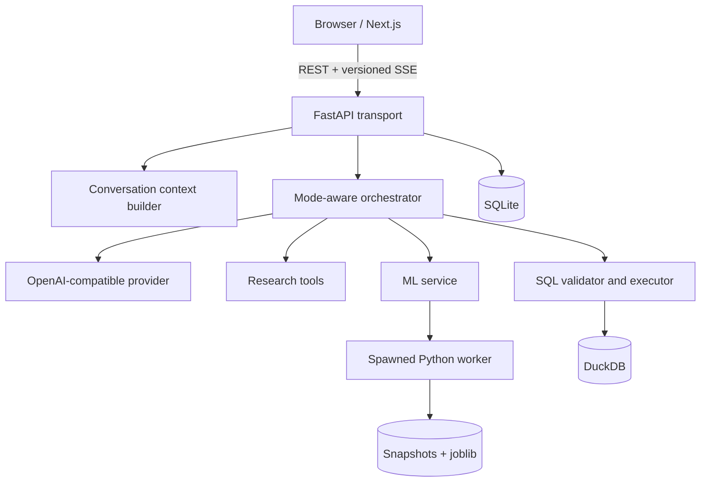

# Architecture

## Component overview

`backend/app/main.py` owns the HTTP boundary and SSE transport.
`agent.py` exposes mode-specific tools and runs the bounded tool loop.
`provider.py` isolates the OpenAI-compatible request/response format.
`sql_tool.py` validates and executes analytical SQL. The `ml/` package defines
typed contracts, preprocessing, supervised and unsupervised operations,
inference, and the child-process worker. `storage.py` owns SQLite metadata and
artifact persistence.

## Data flow

1. `datasets.py` accepts CSV/Parquet, stores the original beneath `DATA_DIR`, and builds a compact profile plus a DuckDB `data` relation.
2. `context.py` combines operating rules, dataset metadata, a bounded summary, and recent messages.
3. The provider returns either a final answer or structured calls to the tools allowed in the selected mode.
4. Tool results are capped, persisted as artifacts, and returned to both the model loop and browser through versioned SSE events.
5. The final answer and compacted conversation state are stored in SQLite.

## Model and inference flow

Research mode exposes only controlled web-search/page-reading tools. SQL mode
exposes query and chart tools. ML mode adds Pydantic-validated operations such
as dataset materialization, training, evaluation, prediction, clustering,
forecasting, and anomaly detection.

The ML service writes an immutable snapshot with provenance and a SHA-256
fingerprint. A spawned worker fits predefined scikit-learn pipelines; it cannot
execute model-generated Python. Supervised candidate selection uses a validation
split, then reports metrics on a separate held-out test split. Saved preprocessing
and estimators live together in a local `joblib` artifact.

## Persistence

- SQLite: sessions, messages, artifacts, ML project/run/model registries
- DuckDB: read-only analytical access to registered datasets and derived snapshots
- Filesystem: original uploads, immutable JSON snapshots, and trusted local model bundles

All three are runtime state and are ignored by Git.

## Failure handling

- malformed provider responses and tool errors become explicit loop errors
- invalid or out-of-scope SQL is rejected before execution
- DuckDB work is interrupted on timeout and result rows are capped
- ML timeouts or cancellation terminate the worker process
- an API restart marks in-flight work interrupted; jobs are not resumed
- the SSE stream emits an error event instead of silently ending

## Security and safety boundaries

- SQL must be a single SELECT-style statement and may reference only `data` or its CTEs.
- Mode ownership is immutable for an existing conversation.
- Prompt context excludes raw full datasets and model chain-of-thought.
- There is no arbitrary Python or shell tool.
- Uploads, databases, snapshots, API keys, and serialized models are local/private data.
- `joblib` artifacts are trusted-local only and must not be loaded from untrusted sources.

## Major interfaces

- Browser to API: JSON REST plus versioned SSE envelopes
- Agent to model: OpenAI-compatible chat completions with structured tools
- Agent to SQL: validated query plus timeout and row-cap contract
- API to ML worker: typed operation request and progress/result messages
- Persistence: repository-specific records in SQLite plus filesystem paths
